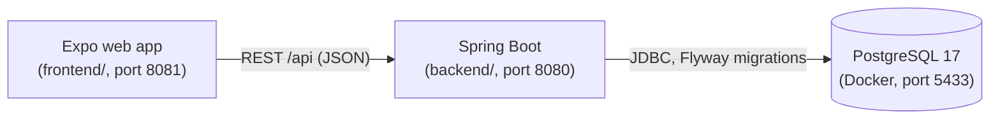

# Inventory & Orders

A portfolio project showing a transactional order-to-return workflow: a Spring Boot + PostgreSQL backend that
reserves stock at checkout without overselling under concurrent load, and an Expo web frontend that drives the
workflows in a browser.

**What it demonstrates**

- Inventory accounting with database-enforced invariants (`0 ≤ reserved ≤ on_hand`, derived `available`).
- Correct behaviour under concurrency: atomic conditional updates, consistent lock order, no deadlocks, tested with
  real parallel transactions against PostgreSQL.
- Explicit lifecycles for reservations, orders, shipments and returns; idempotent transitions and
  `Idempotency-Key` handling for retried requests.
- Partial fulfilment, returns with restock/discard rules and credit notes, and operational reports.
- A REST API with RFC 9457 problem details, schema managed by Flyway, and a typed frontend that keeps all business
  rules on the server.

## Capabilities

| Area         | Features                                                                          |
| ------------ | --------------------------------------------------------------------------------- |
| Inventory    | Products, stock receipts, on-hand / reserved / available quantities               |
| Reservations | Checkout reservations with a TTL, cancellation, automatic expiry                  |
| Orders       | Payment confirmation, partial packing, shipping and delivery                      |
| Returns      | Per-line reason and condition, restock or discard, credit notes, net order totals |
| Reports      | Low stock, inventory aging (FIFO estimate), order cycle time                      |

## Stack

- **Backend:** Java 21, Spring Boot 4.1 (Web MVC, Data JPA, Validation), Hibernate 7, PostgreSQL 17, Flyway,
  Maven Wrapper, JUnit 6, Testcontainers.
- **Frontend:** Expo SDK 58, Expo Router, React Native for web, TypeScript, Jest + React Native Testing Library,
  Playwright.
- **Local infrastructure:** Docker Compose (PostgreSQL).

## Architecture



The frontend is a static single-page app; every quantity, status and total it shows comes from the API. The backend
owns all rules and transactions; the database enforces the invariants with CHECK constraints.

## Repository structure

```
.
├── backend/             Spring Boot application, Maven Wrapper, Compose file for PostgreSQL, start-dev.sh
├── frontend/            Expo web app, Jest tests, Playwright E2E tests
├── infrastructure/      AWS CDK (TypeScript): ECR repository, VPC, internal load balancer, ECS Fargate, RDS PostgreSQL,
│                        S3 + CloudFront frontend, AWS WAF
├── deployment/          Bash scripts that deploy, update, verify, pause and tear down the AWS infrastructure
├── docs/                diagrams: lifecycle state machines and inventory accounting
├── make-source-zip.sh   packages the source (without secrets, dependencies or build output) into a zip
└── README.md
```

## Quick start

Requirements: JDK 21+, Docker with Compose, Node.js 20.19+ (details in the component READMEs). Maven uses the
JDK in `JAVA_HOME`; check it with `cd backend && ./mvnw -v`
([troubleshooting](backend/README.md#troubleshooting)).

```bash
# Terminal 1 – PostgreSQL + backend on http://localhost:8080
cd backend
cp .env.example .env
./start-dev.sh

# Terminal 2 – web frontend on http://localhost:8081
cd frontend
npm install
npm run web
```

Stop the backend with `Ctrl+C` and the database with `cd backend && docker compose stop`.

## Demo workflow

Open <http://localhost:8081>; it starts on the **Demo guide**, which explains both workflows and links every step
to its screen. The **Customer / Administration** switch at the top changes the navigation (a demo convenience, not
access control):

| Mode           | Screens                                                                                          |
| -------------- | ------------------------------------------------------------------------------------------------ |
| Customer       | Shop → Cart → Checkout (simulated payment) → Orders (read-only order status and returns)         |
| Administration | Inventory, Reservations (monitoring), Orders & Fulfilment (pack, ship, deliver, return), Reports |

A suggested run:

1. **Administration → Inventory:** add a product and receive stock.
2. **Customer → Shop → Cart:** add the product to the cart and check out. Checkout reserves the stock for 15
   minutes; overselling is rejected with `INSUFFICIENT_STOCK` and nothing is reserved.
3. **Customer → Checkout:** confirm the simulated payment, which turns the reservation into an order.
4. **Administration → Reservations:** see the confirmed reservation, its expiry and where its stock is held.
5. **Administration → Orders & Fulfilment:** pack, ship and deliver the order in partial shipments, then record a
   return; a credit note adjusts the order totals.
6. **Customer → Orders:** follow the same order, read-only.
7. **Administration → Reports:** low stock, inventory aging and order cycle time.

Details per screen: [frontend README](frontend/README.md#demo-the-workflows). The same flow is available as a
step-by-step [curl walkthrough](backend/README.md#2-walkthrough-with-curl).

## Tests

```bash
cd backend && ./mvnw test        # unit, API, concurrency and workflow tests (Docker required for Testcontainers)

cd frontend
npm run typecheck && npm run lint
npm test                         # Jest unit and component tests
npm run e2e                      # Playwright E2E: starts its own backend on a throwaway database (port 8090)
```

## Documentation

- [backend/README.md](backend/README.md) – setup, configuration, Flyway, API reference, concurrency design, tests
- [frontend/README.md](frontend/README.md) – setup, API URL configuration, tests, production export and deep links
- [docs/lifecycle-state-machines.md](docs/lifecycle-state-machines.md) – reservation, order, shipment and return
  lifecycles
- [docs/inventory-accounting.md](docs/inventory-accounting.md) – quantities, invariants and a worked example
- [infrastructure/README.md](infrastructure/README.md) – AWS architecture: CDK stacks, network, CloudFront, WAF,
  settings
- [deployment/README.md](deployment/README.md) – the only AWS deployment instructions: deploy, update, verify, pause
  and tear down

To package the source for review: `./make-source-zip.sh` (see `./make-source-zip.sh --help`).
