# Inventory accounting

Stored and derived quantities, the operations that change them, the invariants the tests verify, and a numerical
example. The example is executed step by step by `InventoryAccountingExampleTest`.

```mermaid
flowchart TB
    subgraph QTY["Quantities per product"]
        direction LR
        ON["on_hand · stored<br/>units in the warehouse,<br/>including reserved units"]
        RS["reserved · stored<br/>persisted-ACTIVE reservations<br/>+ confirmed order units not yet shipped"]
        AV["available · derived<br/>on_hand − reserved"]
        IT["in transit · derived, not stored or exposed<br/>Σ (shipped − delivered) over order items<br/>= units in SHIPPED shipments"]
        ON --> AV
        RS --> AV
    end

    subgraph OPS["Changes per operation · Δ on_hand / Δ reserved"]
        direction LR
        OP1["receive stock<br/>+q / 0<br/>PURCHASE receipt"]
        OP2["create reservation<br/>0 / +q<br/>only if available ≥ q"]
        OP3["cancel, or sweeper expiry<br/>0 / −q<br/>once, leaving ACTIVE"]
        OP4["confirm payment, pack,<br/>deliver, discarded return<br/>0 / 0"]
        OP5["ship<br/>−q / −q<br/>available unchanged"]
        OP6["restocked return line<br/>+q / 0<br/>RETURN receipt"]
    end

    subgraph INV["Invariants · database CHECK constraints and InvariantChecks"]
        direction LR
        I1["0 ≤ reserved ≤ on_hand<br/>(CHECK, so available ≥ 0)"]
        I2["reserved = Σ q of reservations with persisted status ACTIVE<br/>(including logically expired ones not yet swept)<br/>+ Σ (ordered − shipped) over order items"]
        I3["on_hand = Σ stock receipts (PURCHASE + RETURN)<br/>− Σ shipped"]
        I4["per order item (CHECK):<br/>0 ≤ returned ≤ delivered ≤ shipped ≤ packed ≤ ordered"]
        I5["per order (CHECK):<br/>0 ≤ creditedTotal = Σ credit notes ≤ grossTotal"]
    end

    subgraph EX["Example · one product at 10.00 · on_hand / reserved / available / in transit"]
        direction TB
        E0["receive 10<br/>10 / 0 / 10 / 0"]
        E1["reserve A = 3<br/>10 / 3 / 7 / 0<br/>reserved = A 3"]
        E2["reserve B = 2<br/>10 / 5 / 5 / 0<br/>reserved = A 3 + B 2"]
        E3["confirm A, order created<br/>10 / 5 / 5 / 0<br/>reserved = B 2 + order 3 unshipped"]
        E4["15 min later: B logically expired<br/>persisted ACTIVE, effective EXPIRED<br/>10 / 5 / 5 / 0, nothing released yet"]
        E5["sweeper expires B<br/>10 / 3 / 7 / 0<br/>reserved = order 3 unshipped"]
        E6["pack 3<br/>10 / 3 / 7 / 0"]
        E7["ship<br/>7 / 0 / 7 / 3"]
        E8["deliver, order DELIVERED<br/>7 / 0 / 7 / 0"]
        E9["return 2 units in one return:<br/>line 1 unopened, no longer needed → RESTOCK<br/>line 2 opened, defective → DISCARD<br/>8 / 0 / 8 / 0<br/>credit note 20.00, net total 30.00 − 20.00 = 10.00"]
        E10["check: receipts 10 + 1 RETURN − shipped 3 = 8 = on_hand"]
        E0 --> E1 --> E2 --> E3 --> E4 --> E5 --> E6 --> E7 --> E8 --> E9 --> E10
    end

    QTY ~~~ OPS
    OPS ~~~ INV
    INV ~~~ EX

    classDef derived fill:#eef6ff,stroke:#2b6cb0,stroke-dasharray:5 5
    classDef gap fill:#fff4e5,stroke:#d97706,stroke-dasharray:5 5
    class AV,IT derived
    class E4 gap
```

Notes

- Only `on_hand` and `reserved` are stored, and both change only through single conditional `UPDATE` statements
  (`InventoryRepository`), so concurrent transactions cannot overwrite each other.
- Between expiry time and the sweep, a reservation's units are still counted in `reserved` (step E4); this is what
  keeps invariant I2 true during that interval.
- Restock or discard is decided per return line, so one return can do both (step E9). Discarded units never
  re-enter `on_hand`, but they are refunded like restocked ones.
