# Business lifecycles

Reservation, order, shipment and return lifecycles as implemented, and how they interact. Boxes are persisted
states unless marked otherwise; dotted arrows are effects one lifecycle has on another.

```mermaid
flowchart LR
    subgraph RES["Reservation · persisted in reservation.status"]
        direction TB
        R_NEW(["POST /api/reservations<br/>every line reserved atomically,<br/>otherwise 409 INSUFFICIENT_STOCK"])
        R_ACTIVE["ACTIVE<br/>stock reserved"]
        R_GAP["NOT A PERSISTED STATE<br/>persisted: ACTIVE · effective: EXPIRED<br/>stock still reserved, stockReleasedAt = null<br/>confirm / cancel → 409 RESERVATION_EXPIRED"]
        R_CONFIRMED["CONFIRMED<br/>stock stays reserved, now for the order"]
        R_CANCELLED["CANCELLED<br/>stock released"]
        R_EXPIRED["EXPIRED<br/>stock released, stockReleasedAt set"]
        R_NEW --> R_ACTIVE
        R_ACTIVE -->|"confirm payment<br/>now before expiresAt"| R_CONFIRMED
        R_ACTIVE -->|"cancel<br/>now before expiresAt"| R_CANCELLED
        R_ACTIVE -.->|"clock reaches expiresAt<br/>nothing is written"| R_GAP
        R_GAP -->|"ReservationExpirySweeper only<br/>(scheduled, every 30 s by default)"| R_EXPIRED
    end

    subgraph ORD["Order · customer_order.status"]
        direction TB
        O_CONFIRMED["CONFIRMED<br/>created by payment confirmation"]
        O_FULFILMENT["IN_FULFILMENT"]
        O_DELIVERED["DELIVERED<br/>deliveredAt = last unit delivered"]
        O_CONFIRMED -->|"first shipment packed"| O_FULFILMENT
        O_FULFILMENT -->|"every ordered unit delivered"| O_DELIVERED
    end

    subgraph SHP["Shipment · many per order, each with partial quantities"]
        direction TB
        S_PACKED["PACKED<br/>order item packed += q<br/>no inventory change"]
        S_SHIPPED["SHIPPED<br/>order item shipped += q<br/>on_hand −q, reserved −q"]
        S_DELIVERED["DELIVERED<br/>order item delivered += q<br/>no inventory change"]
        S_PACKED -->|ship| S_SHIPPED
        S_SHIPPED -->|deliver| S_DELIVERED
    end

    subgraph RET["Return · recorded in one step when the goods arrive; no return states"]
        direction TB
        RT_NEW["OrderReturn<br/>lines against delivered, not yet returned units<br/>order item returned += q"]
        RT_RULE{"for each return line:<br/>condition UNOPENED and reason<br/>NO_LONGER_NEEDED or WRONG_ITEM_SENT?"}
        RT_RESTOCK["line disposition RESTOCK<br/>on_hand +q, RETURN stock receipt"]
        RT_DISCARD["line disposition DISCARD<br/>no inventory change"]
        RT_CREDIT["one CreditNote per return<br/>Σ unit price × q over all lines<br/>order creditedTotal += amount"]
        RT_NEW --> RT_RULE
        RT_RULE -->|yes| RT_RESTOCK
        RT_RULE -->|no| RT_DISCARD
        RT_RESTOCK --> RT_CREDIT
        RT_DISCARD --> RT_CREDIT
    end

    R_CONFIRMED -.->|"creates exactly one order<br/>in the same transaction"| O_CONFIRMED
    O_CONFIRMED -.->|"pack, also while IN_FULFILMENT,<br/>up to the unpacked quantity"| S_PACKED
    S_PACKED -.->|"first shipment of the order"| O_FULFILMENT
    S_DELIVERED -.->|"all order items fully delivered"| O_DELIVERED
    S_DELIVERED -.->|"delivered units become returnable"| RT_NEW

    classDef notPersisted fill:#fff4e5,stroke:#d97706,stroke-dasharray:5 5
    classDef released fill:#fdecec,stroke:#c0392b
    class R_GAP notPersisted
    class R_CANCELLED,R_EXPIRED released
```

**Rules the diagram does not show as arrows**

- _Effective status_ is what the API reports: `EXPIRED` once `now ≥ expiresAt`, otherwise the persisted status.
  Only the sweeper writes `EXPIRED` and releases the stock; requests never release expired stock.
- Repeating a transition that already happened is a no-op returning `200`: cancelling a cancelled reservation,
  confirming with the same `paymentReference`, shipping a shipped shipment, delivering a delivered shipment.
  Every other transition not drawn here returns `409`.
- Orders cannot be cancelled after payment, and returns do not change the order status (only its totals).
- Every change to an existing reservation runs under that reservation's row lock, and every change to an order, its
  shipments or its returns runs under the order's row lock, so racing requests take effect one at a time.
